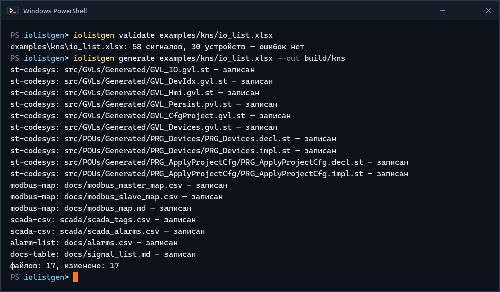
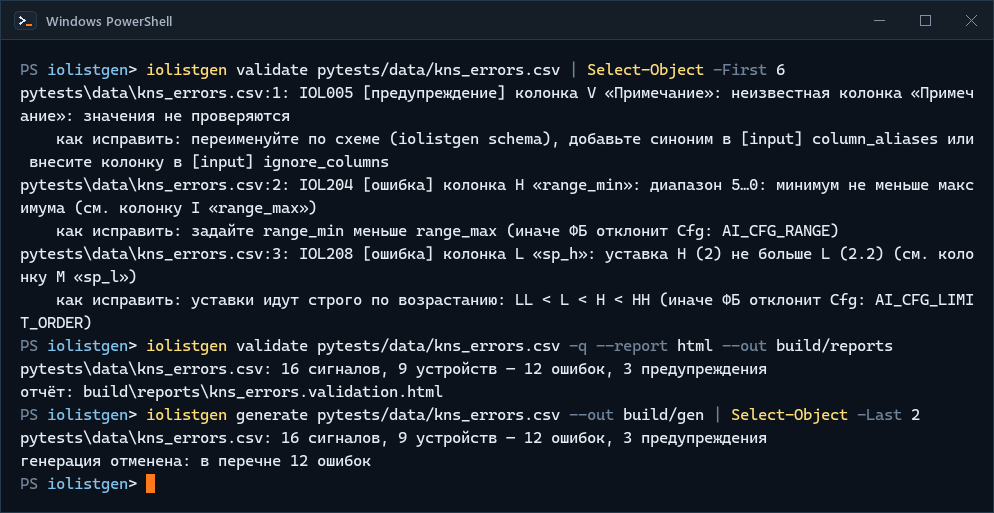
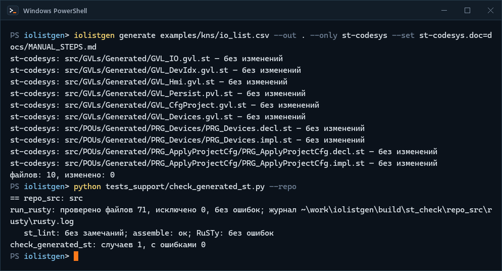
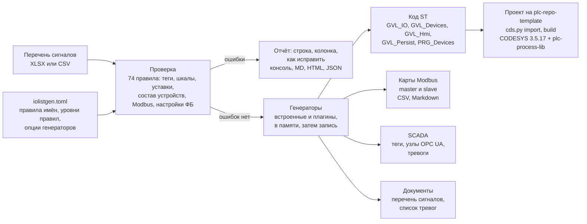

<p align="center">
  <picture>
    <source media="(prefers-color-scheme: dark)" srcset="docs/media/banner-dark.svg">
    <source media="(prefers-color-scheme: light)" srcset="docs/media/banner-light.svg">
    
  </picture>
</p>

<p align="center"><b>Перечень сигналов в Excel или CSV → проверенный слой устройств проекта CODESYS V3.5: GVL, вызовы ФБ, карты Modbus, теги SCADA, список тревог</b></p>

<p align="center">
  <a href="https://github.com/kr0nsch/iolistgen/actions/workflows/ci.yml"></a>
  <a href="https://github.com/kr0nsch/iolistgen/releases/latest"></a>
  <a href="LICENSE"></a>
  
  
  
  <a href="#тесты-и-качество"></a>
</p>

<p align="center">
  <a href="#что-это-и-зачем">Что это</a> ·
  <a href="#как-это-выглядит">Как выглядит</a> ·
  <a href="#быстрый-старт">Быстрый старт</a> ·
  <a href="#как-использовать-в-своём-проекте">Свой перечень</a> ·
  <a href="#как-устроено">Как устроено</a> ·
  <a href="#документация">Документация</a> ·
  <a href="#summary-en">Summary (EN)</a>
</p>

**Генератор слоя устройств проекта CODESYS V3.5 по перечню сигналов (IO list) в Excel или CSV.**
Обычно перечень ведут в Excel, а переменные ввода-вывода, экземпляры функциональных блоков, карту
Modbus и базу тегов SCADA заводят по нему вручную — отсюда дубли тегов, перепутанные шкалы,
пересекающиеся адреса и расхождения ПЛК со SCADA, которые всплывают на пусконаладке. `iolistgen`
проверяет перечень (у каждой ошибки — строка, колонка и как исправить) и одной командой строит по
нему код ST, карты обмена, импорт SCADA и список тревог. Для инженеров АСУ ТП и интеграторов на CODESYS.

## Что это и зачем

Утилита командной строки на Python. Вход — таблица, где одна строка — один сигнал: канал модуля
ввода-вывода или значение по Modbus. Строки с общим тегом устройства (колонка `device`) — одно
устройство, то есть один экземпляр функционального блока (ФБ) из открытой библиотеки
[plc-process-lib](https://github.com/kr0nsch/plc-process-lib): аналоговый и дискретный датчик,
двигатель, насос с преобразователем частоты (ПЧ), задвижка, регулирующий клапан, ПИД-регулятор.
Сначала перечень проверяется, затем по нему пишутся файлы — сразу по местам проекта из шаблона
[plc-repo-template](https://github.com/kr0nsch/plc-repo-template):

| Что генерируется | Куда (`--out .` — корень проекта) |
|---|---|
| код ST для CODESYS: переменные каналов и Modbus (`GVL_IO`), экземпляры ФБ (`GVL_Devices`), команды HMI (`GVL_Hmi`), уставки и сохраняемые данные устройств (`GVL_Persist`), вызовы ФБ со всеми привязками (`PRG_Devices`), «применить уставки проекта» | `src/GVLs/Generated/`, `src/POUs/Generated/` |
| карты обмена Modbus: master — опрос приборов, slave — состояния устройств для SCADA | `docs/modbus_master_map.csv`, `docs/modbus_slave_map.csv`, `docs/modbus_map.md` |
| импорт тегов SCADA: пути переменных ПЛК, узлы OPC UA, единицы, шкалы, уставки; тревоги | `scada/scada_tags.csv`, `scada/scada_alarms.csv` |
| список тревог: номер, приоритет, текст, причина, последствие, действие оператора, уставка, задержка | `docs/alarms.csv` |
| «Перечень сигналов» для документации с колонкой «Переменная ПЛК» | `docs/signal_list.md` |

**Что даёт**

- **Ошибки перечня — до ПЛК, а не на объекте.** 74 правила: теги (дубли без учёта регистра,
  кириллица вместо латиницы), шкалы и уставки (LL < L < H < HH внутри шкалы), состав устройств (ПЧ
  без задания частоты, задвижка без «Закрыть»), пересечения адресов Modbus с учётом длины типа и
  битов, два сигнала на одном канале модуля, параметры ФБ, которые библиотека отклонила бы при
  старте. У каждого сообщения — строка, колонка и «как исправить»; отчёт — в консоли, Markdown,
  HTML или JSON.
- **Код ПЛК, карты Modbus и база SCADA из одного источника.** После правки перечня одна команда
  обновляет всё, имя переменной в карте Modbus и в импорте SCADA совпадает с объявлением в ПЛК.
- **Код собирается.** Код по перечню КНС-1 (58 сигналов, 30 устройств) собран в CODESYS 3.5.17.30
  с plc-process-lib 1.0.0.0 без ошибок и предупреждений; тесты в программном ПЛК подтвердили, что
  библиотека принимает конфигурацию каждого устройства.
- **Удобно ревьюить.** Генерация детерминирована: повторный запуск, как и пересохранение книги Excel
  без правок, не меняет ни одного файла, дифф в pull request показывает только изменения перечня.
  Генерация выполняется целиком или никак: при ошибке ни один файл не пишется.
- **Excel как есть.** Русские заголовки («Тег», «Тип сигнала»), объединённые ячейки, подзаголовки
  разделов, титул над таблицей, десятичная запятая, минус «−» из паспорта прибора.
- **Расширяется.** Свои генераторы — плагины на Python, свои шаблоны кода — Jinja2.

**Для кого**

- инженеры АСУ ТП и интеграторы на CODESYS V3.5, у которых перечень сигналов ведётся в Excel, а
  GVL, экземпляры и вызовы ФБ, карты Modbus и база SCADA заводятся по нему вручную;
- группы, которые ведут код ПЛК в git по [plc-repo-template](https://github.com/kr0nsch/plc-repo-template):
  сгенерированный код ложится в его раскладку `src/` и собирается его скриптом `cds.py`;
- технические руководители, которые оценивают подход «перечень сигналов — источник истины».

**Платформа.** Python 3.10+, Windows и Linux; для проверки и генерации CODESYS не нужен.
Сгенерированный код — для CODESYS V3.5 (проверено на 3.5.17.30) и plc-process-lib 1.0.0
(пространство имён `PL`); целевой ПЛК — ОВЕН ПЛК210, на контроллере код не запускался.

<details>
<summary>Термины: перечень сигналов, ФБ, GVL, Persistent Variables, Retain, Cfg, роль, dev_no, AUX</summary>

| Термин | Что это |
|---|---|
| перечень сигналов (IO list) | таблица всех сигналов объекта: тег, описание, тип сигнала, шкала, уставки, канал модуля или адрес Modbus |
| ФБ | функциональный блок библиотеки plc-process-lib (`PL.FB_AnalogInput`, `PL.FB_MotorVfd`…): одно устройство — один экземпляр |
| GVL | список глобальных переменных CODESYS |
| Persistent Variables, Retain | объект CODESYS с переменными, которые переживают перезагрузку и загрузку программы; здесь — уставки и наработка устройств (`GVL_Persist`) |
| Cfg | структура настроек ФБ (`PL.ST_MotorCfg`…): шкала, уставки, задержки, приоритеты тревог |
| роль (`role`) | к какому входу или выходу ФБ привязан сигнал: `PV` — измерение, `CMD_RUN` — команда «Работа», `RUN_FB` — обратная связь (ОС) «в работе»… |
| главная строка | строка устройства с главной ролью (у двигателя — `CMD_RUN`): в ней тип, номер, уставки и параметры устройства |
| `dev_no` | постоянный номер устройства: от него номера тревог (`dev_no · 10 + слот`) и порядок сохраняемых данных |
| `AUX` | сигнал без ФБ: лампа, сирена, резервный канал; получает переменную, место в картах и тег SCADA, логику пишет код станции |
| КНС-1 | вымышленная канализационная насосная станция — пример перечня в `examples/kns/` |

</details>

## Как это выглядит

Реальные прогоны iolistgen 0.2.0 в клоне репозитория: Windows 11, PowerShell, 19.10.2026. Вывод
команд — как есть, макетов нет.

**Перечень КНС-1 → код ПЛК и карты обмена** — проверка книги Excel и генерация всех файлов:

<p align="center">
  
</p>
<p align="center"><sub>Реальный прогон, Windows PowerShell, снято term2gif.py</sub></p>

**Перечень с ошибками** — у каждого сообщения строка, колонка, правило и способ исправления; по
такому перечню генерация отменяется:

<p align="center">
  
</p>
<p align="center"><sub>Реальный прогон по учебному перечню <code>pytests/data/kns_errors.csv</code>; вывод первой команды обрезан <code>Select-Object -First 6</code> — 3 сообщения из 15</sub></p>

**HTML-отчёт проверки** — те же сообщения таблицей, с фильтром «ошибки/предупреждения» и поиском
по тегу; светлая и тёмная тема по настройке системы:

<p align="center">
  <picture>
    <source media="(prefers-color-scheme: dark)" srcset="docs/media/shot-validation-report-dark.png">
    <source media="(prefers-color-scheme: light)" srcset="docs/media/shot-validation-report-light.png">
    
  </picture>
</p>
<p align="center"><sub>Отчёт <code>iolistgen validate --report html</code> по тому же перечню, iolistgen 0.2.0, снято shot.py (верх страницы)</sub></p>

**Сгенерированный код без CODESYS** — повторная генерация кода КНС-1 в корень репозитория ничего не
меняет, а `src/` вместе с заглушкой plc-process-lib проходит линтер и открытый компилятор RuSTy:

<p align="center">
  
</p>
<p align="center"><sub>Реальный прогон, Windows PowerShell, снято term2gif.py; домашний каталог в пути журнала заменён на <code>~</code></sub></p>

Сборка того же `src/` в CODESYS — в [«Тестах и качестве»](#тесты-и-качество); запись экрана IDE не
делалась.

## Быстрый старт

Два уровня: проверка и генерация работают на любой машине с Python; сборка примера в CODESYS — на
Windows с установленным CODESYS. Железо ПЛК не нужно ни там, ни там.

### Без CODESYS: Windows или Linux

Нужно: Python 3.10+ и git.

1. Получить код:

   ```bash
   git clone https://github.com/kr0nsch/iolistgen.git
   cd iolistgen
   ```

   Увидите: `Cloning into 'iolistgen'...`; в каталоге — `iolistgen/`, `examples/`, `docs/`, `src/`.

2. Создать окружение и установить пакет:

   ```bash
   python -m venv .venv          # Linux: python3 -m venv .venv (в Debian/Ubuntu — пакет python3-venv)
   source .venv/bin/activate     # Git Bash: source .venv/Scripts/activate
   python -m pip install .
   iolistgen --version
   ```

   В cmd окружение включает `.venv\Scripts\activate.bat`, в PowerShell — `.venv\Scripts\Activate.ps1`
   (если PowerShell запрещает скрипты — `Set-ExecutionPolicy -Scope Process -ExecutionPolicy Bypass`,
   действует только в этом окне). Вместо окружения можно `pipx install .` — так ставит CI.

   Увидите: `Successfully installed … iolistgen-0.2.0 …` и `iolistgen 0.2.0`.

3. Проверить перечень примера — CSV и та же книга Excel:

   ```bash
   iolistgen validate examples/kns/io_list.csv
   iolistgen validate examples/kns/io_list.xlsx
   ```

   Увидите: `examples/kns/io_list.csv: 58 сигналов, 30 устройств — ошибок нет` и то же для `.xlsx`;
   код выхода 0. В Windows путь в выводе печатается через `\`.

4. Посмотреть, как выглядят ошибки, — перечень, где почти в каждой строке одна намеренная ошибка:

   ```bash
   iolistgen validate examples/broken/io_list_broken.csv --report html --out build
   ```

   Увидите сообщения вида

   ```text
   examples/broken/io_list_broken.csv:2: IOL204 [ошибка] колонка H «range_min»: диапазон 5…0: минимум не меньше максимума (см. колонку I «range_max»)
       как исправить: задайте range_min меньше range_max (иначе ФБ отклонит Cfg: AI_CFG_RANGE)
   ```

   и в конце `37 сигналов, 24 устройства — 30 ошибок, 3 предупреждения`, `отчёт:
   build/io_list_broken.validation.html`; код выхода 1. Отчёт откройте в браузере.

5. Сгенерировать все файлы по перечню КНС-1:

   ```bash
   iolistgen generate examples/kns/io_list.csv --out build/kns
   ```

   Увидите 17 строк вида `st-codesys: src/GVLs/Generated/GVL_IO.gvl.st — записан` и итог
   `файлов: 17, изменено: 17`. Повторный запуск — `файлов: 17, изменено: 0`. Результат — в
   `build/kns/`: `src/` (код ST), `docs/` (карты Modbus, тревоги, перечень), `scada/`.

6. Справочники — тут же, в консоли:

   ```bash
   iolistgen schema --section columns     # колонки перечня; ещё: device-types, roles, params, rules
   iolistgen generate --list              # генераторы и их опции
   ```

   Увидите таблицы Markdown: колонки с русскими синонимами заголовков, типы устройств, роли, все
   74 правила проверки.

<details>
<summary><b>Тесты пакета: ruff, mypy, pytest</b></summary>

```bash
python -m pip install -r requirements-dev.txt
python -m ruff check .
python -m ruff format --check .
python -m mypy
python -m pytest
```

Увидите: ruff и mypy без замечаний, `1452 passed, 31 skipped` примерно за полминуты. Пропущены
интеграционные тесты, которым нужны RuSTy и iec_checker (19), и сверка каталога с исходниками
plc-process-lib (12; нужен клон `../plc-process-lib` или переменная `PL_REPO`). Со всеми тремя —
`1483 passed`. Где взять RuSTy и iec_checker — [tools/README.md](tools/README.md#checkrun_rustypy--проверка-rusty).

На Windows без включённых длинных путей клонируйте в короткий каталог, например `C:\src\`: при пути
к клону около 155 символов `pip` не смог распаковать в `.venv` пакет lxml из `requirements-dev.txt`.

</details>

### С CODESYS: сборка примера КНС-1 (Windows)

`src/` этого репозитория — код по перечню КНС-1, сгенерированный iolistgen, плюс ручной `PRG_Main`
(регулятор уровня и вызов `PRG_Devices`); `tests/` — набор coUnit `FB_ProjectCfg_Test`. Команды ниже
запускают CODESYS без окна, каждая — 10–20 секунд; журналы — в `build/`.

| Что нужно | Версия | Где взять |
|---|---|---|
| CODESYS с CODESYS Control Win V3 | 3.5.17.30 (V3.5 SP17 Patch 3) | [MANUAL_STEPS.md, раздел 1](docs/MANUAL_STEPS.md#1-установка-codesys-351730) |
| coUnit (CfUnit) | 1.2.0.0 | [MANUAL_STEPS.md, раздел 2](docs/MANUAL_STEPS.md#2-counit-cfunit-1200) |
| plc-process-lib | 1.0.0.0, тег `v1.0.0` | клон рядом с репозиторием (шаг 1): `cds.py` соберёт и установит библиотеку, если её нет |
| Python | 3.11+ | сторонние пакеты для `cds.py` не нужны; права администратора не нужны |

1. Положить библиотеку рядом и один раз подготовить рантайм — CODESYS Control Win V3 в
   пользовательском процессе ([MANUAL_STEPS.md, раздел 4](docs/MANUAL_STEPS.md#4-рантайм-codesys-control-win-v3-без-прав-администратора)):

   ```bat
   git clone --branch v1.0.0 https://github.com/kr0nsch/plc-process-lib.git ..\plc-process-lib
   python tools\codesys\cds.py runtime init
   ```

2. Создать проект из `src/`, затем один раз — объект Persistent Variables `GVL_Persist` (скрипт
   CODESYS 3.5.17 его не создаёт, поэтому `import` предупреждает о `GVL_Persist.pvl.st`):

   ```bat
   python tools\codesys\cds.py import
   python tools_project\codesys_pvl.py
   ```

3. Собрать:

   ```bat
   python tools\codesys\cds.py build
   ```

   Итог прогона 19.10.2026: `build: OK (ошибок 0, предупреждений 0)`.

4. Прогнать тесты в Control Win V3 (тестовому проекту тоже нужен `GVL_Persist`):

   ```bat
   python tools\codesys\cds.py import --tests
   python tools_project\codesys_pvl.py --tests
   python tools\codesys\cds.py test
   ```

   Итог прогона 19.10.2026: `test: OK (наборов 1, тестов 4, пройдено 4, упало 0, пропущено 0)`;
   результаты — `build/test-results.json`, `build/junit.xml`.

Подробно, с проверкой всех объектов (`cds.py check`) и тем, чего не делать (`import --clean`,
`roundtrip` удаляют объект Persistent Variables), —
[MANUAL_STEPS.md, раздел 9](docs/MANUAL_STEPS.md#9-код-сгенерированный-iolistgen-в-проекте-codesys).

## Как использовать в своём проекте

Сценарий — проект ПЛК в git, созданный из [plc-repo-template](https://github.com/kr0nsch/plc-repo-template):
сгенерированный код ложится в его раскладку `src/`, а `cds.py` шаблона собирает проект CODESYS.
Шаги 1–5 проверены 19.10.2026 в чистом клоне шаблона на перечне из пяти строк ниже. Шаги в CODESYS
повторяют порядок, по которому собран пример КНС-1 в этом репозитории; в проекте из шаблона они не
запускались. Подробно, со шпаргалкой колонок, частыми ошибками и насосом с ПЧ по Modbus, —
[docs/USAGE.md](docs/USAGE.md).

1. **Установить iolistgen** в окружение проекта (Python 3.10+):

   ```bash
   python -m pip install "git+https://github.com/kr0nsch/iolistgen.git@v0.2.0"
   ```

   Увидите: `Successfully installed … iolistgen-0.2.0 …`.

2. **Описать перечень** — например, `docs/io_list.csv` (UTF-8, разделитель `;`) или книга Excel.
   Проще всего начать с копии примера: в строке заголовка `examples/kns/io_list.csv` — все 31
   колонка схемы, в книге `examples/kns/io_list.xlsx` — те же колонки с русскими заголовками.
   Главное о формате:

   - одна строка — один сигнал; в заголовке обязательны `tag`, `description`, `signal_type` (AI, DI,
     DO, AO или MB — Modbus), `device_type` и `dev_no`;
   - строки с одинаковым `device` — одно устройство; тип, номер, уставки и параметры устройства
     пишутся в его главной строке (у двигателя — строка `CMD_RUN`), у одиночного датчика `device`
     можно не заполнять — устройством станет сам сигнал;
   - `role` — к какому входу или выходу ФБ идёт сигнал (у AI и DI по умолчанию `PV` и `IN`); сигнал
     без ФБ — роль `AUX`;
   - `dev_no` — постоянный номер устройства (1…9999): после пуска объекта не перенумеровывать, от
     него зависят номера тревог и сохранённые в ПЛК уставки;
   - любое поле настроек ФБ — в `params`: `tMinStop=T#10S; uiMaxStartsPerHour=6`.

   Пример — уровнемер, реле контроля фаз и вытяжной вентилятор; строки дословно из
   `examples/kns/io_list.csv`, заголовок — тот же:

   ```text
   tag;description;signal_type;device;device_type;dev_no;role;dev_desc;range_min;range_max;units;sp_hh;sp_h;sp_l;sp_ll;delay_on_s;delay_off_s;alarm_priority;hmi_group;io_module;io_channel;mb_link;mb_slave;mb_func;mb_reg;mb_type;mb_bit;mb_order;link_power;link_fb;params
   LT101;Уровень в приёмном резервуаре;AI;;AnalogInput;101;PV;;0;5;м;4;3,5;0,8;0,5;3;;High;Резервуар;A1;1;;;;;;;;;;"tFilter=T#2S; astLimit[HH].rHyst_eu=0.05; astLimit[H].rHyst_eu=0.05; astLimit[L].rHyst_eu=0.05; astLimit[LL].rHyst_eu=0.05"
   ES301;Напряжение на вводе в норме (реле контроля фаз);DI;;DigitalInput;301;IN;;;;;;;;;3;;High;Электроснабжение;D1;4;;;;;;;;;;xAlarmOnTrue=FALSE
   V1_RUN;Вентилятор В1: команда «Работа»;DO;V1;Motor;14;CMD_RUN;Вытяжной вентилятор В1 павильона;;;;;;;;5;5;Low;Павильон;Q1;4;;;;;;;;ES301;;tMinStop=T#10S
   V1_RFB;Вентилятор В1: в работе (блок-контакт пускателя);DI;V1;;;RUN_FB;;;;;;;;;;;;Павильон;D1;11;;;;;;;;;;
   V1_FLT;Вентилятор В1: авария (автомат защиты двигателя);DI;V1;;;FAULT;;;;;;;;;;;;Павильон;D1;12;;;;;;;;;;
   ```

   Что здесь записано: `LT101` — аналоговый вход 4–20 мА, шкала 0…5 м, уставки HH/H/L/LL с
   задержкой 3 с, канал 1 модуля A1; `ES301` — реле контроля фаз, тревога при пропадании
   напряжения (`xAlarmOnTrue=FALSE`); `V1` — двигатель из трёх строк: команда «Работа» (главная
   строка: тип `Motor`, номер 14, задержки ОС 5 с, минимальное время стоянки 10 с), ОС «в работе»
   и авария, разрешение работы — от `ES301` (`link_power`). Все колонки — `iolistgen schema
   --section columns` и [docs/schema.md](docs/schema.md#2-колонки).

3. **Проверить и прочитать отчёт:**

   ```bash
   iolistgen validate docs/io_list.csv --report html --out build/reports
   ```

   Увидите: `docs/io_list.csv: 5 сигналов, 3 устройства — ошибок нет`, код выхода 0, отчёт —
   `build/reports/io_list.validation.html`. Если бы в строке вентилятора была опечатка
   `tMinStopp`, а ОС «в работе» попала на канал реле фаз D1.4, вывод был бы таким (код выхода 1):

   ```text
   docs/io_list.csv:4: IOL502 [ошибка] колонка AE «params»: params: нет поля «tMinStopp» в ST_MotorCfg
       как исправить: возможно, tMinStop
   docs/io_list.csv:5: IOL601 [ошибка] колонка U «io_channel»: канал DI 4 модуля D1 уже занят сигналом ES301 (см. строку 3)
       как исправить: у каждого физического канала один сигнал: проверьте io_module и io_channel
   docs/io_list.csv: 5 сигналов, 3 устройства — 2 ошибки
   ```

   Как читать: `файл:строка` — номер строки в файле, как в Excel (заголовок — строка 1); `IOL502` —
   код правила (список — `iolistgen schema --section rules`); `[ошибка]` блокирует генерацию,
   `[предупреждение]` — нет (с `--strict` — тоже блокирует); дальше — колонка (буква и заголовок)
   и что не так; вторая строка — как исправить. HTML-отчёт показывает то же таблицей с фильтром и
   поиском (снимок выше), `--report md` — для pull request, `--format json` — для CI. Коды выхода: 0 —
   ошибок нет, 1 — в перечне ошибки, 2 — неверные аргументы, настройки или файл.

4. **Сгенерировать** в корень проекта:

   ```bash
   iolistgen generate docs/io_list.csv --out . --strict
   ```

   Увидите 17 строк `… — записан` и `файлов: 17, изменено: 17`: ST — в `src/GVLs/Generated/` и
   `src/POUs/Generated/`, карты Modbus, список тревог и перечень — в `docs/`, импорт SCADA — в
   `scada/`. С ошибками в перечне — `генерация отменена: в перечне 2 ошибки`, код выхода 1, ни один
   файл не записан. Файлы `Generated` руками не правят: исправляют перечень и генерируют заново;
   свой код (логика станции, адаптеры ПЧ, слой Modbus) лежит рядом, вне `Generated`.

5. **Проверки шаблона без CODESYS.** `python tools/check/st_lint.py --strict` — `st_lint: файлов 70,
   ошибок 0, предупреждений 0`. iec_checker выдаёт по сгенерированному `PRG_Devices` одну находку
   `PLCOPEN-L17` (IF без ELSE): пока она не обоснована, CI шаблона падает на pytest. Готовая запись
   для `tools/check/iec_checker_allow.toml` — в [таком же файле](tools/check/iec_checker_allow.toml)
   этого репозитория (`file = "src/POUs/Generated/PRG_Devices/PRG_Devices.impl.st"`); с ней —
   `необоснованных 0`, pytest шаблона проходит.

6. **В CODESYS** (Windows; в проекте из шаблона не запускалось):

   - подключить plc-process-lib 1.0.0.0 в `tools/codesys/config.json` — запись в `libraries` и ключ
     в `library.libraries` ([MANUAL_STEPS.md, 9.2](docs/MANUAL_STEPS.md#92-библиотека-plc-process-lib));
   - вызвать `PRG_Devices();` из `PRG_Main` после логики станции;
   - `python tools\codesys\cds.py import`, затем один раз создать объект Persistent Variables
     `GVL_Persist`: в IDE «Приложение → Добавить объект → Persistent Variables», сохранить, закрыть
     IDE и `cds.py import --force` — или скопировать из этого репозитория `tools_project/codesys_pvl.py`
     и `codesys_pvl_cds.py` и запустить `python tools_project\codesys_pvl.py`
     ([9.3](docs/MANUAL_STEPS.md#93-импорт-в-проект-и-persistent-variables));
   - `python tools\codesys\cds.py build`.

   Каналы модулей привязывают в дереве устройств к переменным `GVL_IO`, Modbus настраивают по
   `docs/modbus_master_map.csv`, слово состояния ПЧ разбирает адаптер приложения
   ([9.5](docs/MANUAL_STEPS.md#95-каналы-модулей-modbus-адаптеры-пч)) — это ручная работа.

Дальше при каждой правке перечня: `validate` → `generate … --out . --strict` → `git diff` →
`cds.py build`. Ключ `--strict` останавливает генерацию и на предупреждениях сверки `GVL_Persist`
(«тип изменился», «переменная удалена»): такая правка стёрла бы в ПЛК сохранённые уставки и наработку.

### Перечень → код

Строки вентилятора В1 дают в `PRG_Devices` вызов ФБ со всеми привязками, а в `GVL_Persist` —
настройки из колонок и `params` и номер первой тревоги `dev_no · 10`. Задержки ОС 5 с совпадают с
умолчанием `ST_MotorCfg`, поэтому в инициализаторе их нет; приоритеты слотов тревог — от
`alarm_priority` по правилам типа устройства:

```st
// --- dev_no 14: V1 — Вытяжной вентилятор В1 павильона (Motor) ---
GVL_Devices.fbV1(
    xFbRun    := GVL_IO.xV1_RFB,
    xExtFault := GVL_IO.xV1_FLT,
    xPowerOk  := GVL_Devices.fbES301.xValue,  // link_power
    stCmd     := GVL_Hmi.stV1Cmd,
    stCfg     := GVL_Persist.stV1Cfg,
    stRetain  := GVL_Persist.stV1Retain);
GVL_IO.xV1_RUN := GVL_Devices.fbV1.xQRun;

// GVL_Persist.pvl.st (VAR_GLOBAL PERSISTENT RETAIN), по возрастанию dev_no
    stV1Cfg : PL.ST_MotorCfg := (
        tMinStop := T#10S,
        udiAlarmIdBase := 140,
        astAlarm := [
            (ePriority := PL.E_AlarmPriority.Low),  // 0 FailToStart
            (ePriority := PL.E_AlarmPriority.Low),  // 1 FeedbackLost
            (ePriority := PL.E_AlarmPriority.High),  // 2 FailToStop
            (ePriority := PL.E_AlarmPriority.High),  // 3 UncommandedRun
            (ePriority := PL.E_AlarmPriority.Low),  // 4 ExtFault
            (ePriority := PL.E_AlarmPriority.None),  // 5 InterlockTrip
            (ePriority := PL.E_AlarmPriority.Medium),  // 6 CommLoss
            (ePriority := PL.E_AlarmPriority.Low)  // 7 SpeedDeviation
        ]
    );
    stV1Retain : PL.ST_DeviceRetain;  // режим, вывод из работы, наработка, операции
```

Фрагмент сверяет тест: он дословно совпадает с выводом генератора по перечню КНС-1 (по пяти
строкам выше получается тот же текст). Каналы объявлены в `GVL_IO` без адресов `AT`
(`xV1_RUN : BOOL;  // Q1.4 · V1_RUN · Вентилятор В1: команда «Работа»`) и привязываются в дереве
устройств. Насос с ПЧ по Modbus — [USAGE.md, раздел 5](docs/USAGE.md#5-пример-насос-с-пч-по-modbus).

## Как устроено



- **Схема перечня повторяет устройство библиотеки** plc-process-lib: роли — входы и выходы её ФБ,
  `params` — поля её структур настроек. Проверка повторяет условия `CheckConfig` каждого ФБ:
  конфигурацию, которую библиотека отклонит при старте, валидатор ловит раньше; совпадение
  проверено тестами в CODESYS.
- **Генерация целиком или никак:** генераторы работают в памяти, файлы пишутся, только если все
  отработали без ошибок; файл перезаписывается, только если изменилось содержимое.
- **У каждого файла заголовок** `AUTO-GENERATED by iolistgen <версия> — не редактировать` и SHA-256
  содержимого перечня — видно, из какой версии перечня он получен.
- **Каталог библиотеки сверяется с исходниками выпуска** скриптом `tests_support/check_library.py`:
  типы, умолчания, входы и выходы ФБ, константы и тексты тревог.

| Каталог | Что внутри |
|---|---|
| `iolistgen/` | пакет: загрузка CSV и XLSX (`loaders/`), модель перечня, правила проверки, отчёты (`report/`), генераторы (`generators/`), шаблоны Jinja2 (`templates/`), каталог библиотеки |
| `examples/` | перечни: КНС-1 (CSV и XLSX), синтетический на 300 сигналов, витрина ошибок; скрипты `csv_to_xlsx.py`, `benchmark.py` |
| `src/`, `tests/` | пример КНС-1 для CODESYS: сгенерированные `Generated/` и ручной `PRG_Main`; набор coUnit `FB_ProjectCfg_Test` |
| `pytests/` | тесты пакета (pytest, hypothesis), учебные перечни `data/`, эталонные файлы генераторов `golden/` |
| `tests_support/` | заглушка plc-process-lib для RuSTy, проверка сгенерированного ST, сверка каталога с исходниками библиотеки |
| `tools_project/` | `codesys_pvl.py` — создаёт объект Persistent Variables в проекте `cds.py` |
| `tools/` | инструменты из plc-repo-template: `cds.py` (CODESYS из консоли), склейка ST, линтер, обёртки iec_checker и RuSTy |
| `plugins/` | заготовка плагина для MasterSCADA 4D |
| `docs/` | руководства, справочник схемы, отчёты проверок, медиа README |

Модули пакета и потоки данных — [docs/ARCHITECTURE.md](docs/ARCHITECTURE.md#пакет-iolistgen).

## Тесты и качество

| Проверка | Где | Что проверяет |
|---|---|---|
| pytest `pytests/` | CI, Python 3.10, 3.12, 3.13 | каждое правило — срабатывание и тишина на исправленном перечне; загрузчики CSV и XLSX (разделители, BOM, cp1251, объединённые ячейки, числа Excel); зеркало `CheckConfig`; отчёты; плагины; CLI, в том числе «генерация целиком или никак»; hypothesis: поиск пересечений Modbus против полного перебора |
| эталонные файлы | pytest | вывод всех генераторов по малому перечню совпадает с `pytests/golden/` побайтно, повторный запуск ничего не меняет |
| примеры | pytest | КНС-1 и синтетический перечень проходят проверку без сообщений; XLSX даёт ту же модель, что CSV; у каждой строки витрины ошибок — ожидаемое сообщение; фрагмент ST в README — из вывода генератора |
| сгенерированный ST | pytest, CI | st_lint и RuSTy по заглушке plc-process-lib для малых перечней, КНС-1 и синтетического; отрицательный контроль — испорченный вызов RuSTy отклоняет |
| `src/` репозитория | pytest, CI | файлы `Generated` — побайтно вывод генератора по КНС-1; st_lint, iec_checker ([обоснования](docs/STATIC_ANALYSIS.md)), RuSTy |
| каталог против библиотеки | pytest, если рядом исходники plc-process-lib | перечисления, настройки с умолчаниями, входы и выходы ФБ, константы и тексты тревог совпадают с выпуском 1.0.0 |
| ruff, mypy `--strict`; сборка wheel, `pipx install .` | CI | пакет, тесты, скрипты; команда `iolistgen` работает из установленного пакета |
| CODESYS 3.5.17.30 | локально, Windows | `cds.py check`, `build`, `test` — сборка с plc-process-lib 1.0.0.0, coUnit в Control Win V3 |

**Что проверено.**

- **В CODESYS 3.5.17.30 / CODESYS Control Win V3** (19.10.2026, коммит `ab0f622`): пример КНС-1 —
  код по `examples/kns/io_list.csv` и ручной `PRG_Main` — собран с plc-process-lib 1.0.0.0: 0 ошибок
  и 0 предупреждений (`build`, а также `check` всех объектов `src/` и `tests/`); 4 из 4 тестов coUnit
  набора `FB_ProjectCfg_Test`: настройки всех 30 устройств принимает `CheckConfig` библиотеки,
  инициализаторы настроек и «применить уставки проекта» работают. Отрицательный контроль — испорченная
  настройка насоса — тест роняет. После `ab0f622` в `src/` и `tests/` менялась только строка «Автор»
  в заголовках. Подробно — [docs/TEST_REPORT.md](docs/TEST_REPORT.md).
- **Без CODESYS** на текущих исходниках: pytest — 1483 пройдено (с RuSTy, iec_checker и исходниками
  plc-process-lib рядом; без них — 1452 пройдено, 31 пропущено), ruff и mypy `--strict` без
  замечаний, st_lint без замечаний, iec_checker — 0 необоснованных находок, RuSTy — 0 ошибок.
- **На железе ничего не запускалось:** ни ПЛК210, ни модули ввода-вывода, ни обмен Modbus с
  приборами, ни импорт тегов в SCADA. Проект из plc-repo-template с кодом iolistgen проверен без
  CODESYS (st_lint, iec_checker, pytest шаблона), в CODESYS — нет.

**CI** (`.github/workflows/ci.yml`) на каждый push и pull request: ruff, mypy, pytest на Python 3.10,
3.12 и 3.13, сборка wheel и установка через pipx, проверки ST без CODESYS (assemble, st_lint,
iec_checker v0.4); необязательные задания — RuSTy и iec_checker nightly. Сборки и тестов в CODESYS
в CI нет: их запускают на Windows (см.
[«С CODESYS»](#с-codesys-сборка-примера-кнс-1-windows)) или на своём раннере через
[plc-ci-toolkit](https://github.com/kr0nsch/plc-ci-toolkit).

**Скорость.** Проверка и генерация в одном процессе и команда `iolistgen generate` целиком — со
стартом Python и импортом зависимостей, которые занимают большую часть её времени:

<!-- BEGIN benchmark -->
| Перечень | Сигналов | Проверка, мс | Генерация, мс | Проверка + генерация, мс | `iolistgen generate` целиком, мс |
|---|---:|---:|---:|---:|---:|
| `io_list_300.csv` | 300 | 51,2 | 154,3 | **205,5** | 1128,7 |
| `io_list.csv` | 58 | 11,7 | 65,8 | **77,5** | 987,6 |

Медианы; AMD Ryzen 7 7800X3D 8-Core Processor, логических ядер: 16, Windows-11-10.0.26300-SP0, CPython 3.12.10. Генераторы, методика и разброс — [benchmark.md](docs/benchmark.md); повторить — `python examples/benchmark.py`.
<!-- END benchmark -->

Проверки ST без CODESYS для сгенерированного кода — `python tests_support/check_generated_st.py`
(малые перечни, КНС-1, синтетический) или `--list <перечень>` для своего перечня.

## Документация

| Документ | На какой вопрос отвечает |
|---|---|
| [docs/USAGE.md](docs/USAGE.md) | как описать перечень своего объекта, проверить его, сгенерировать код и подключить к проекту из plc-repo-template; шпаргалка колонок, частые ошибки, насос с ПЧ |
| [docs/schema.md](docs/schema.md) | что значит каждая колонка, роль, параметр настроек ФБ и правило проверки (полный справочник) |
| [docs/CLI.md](docs/CLI.md) | какие у команд ключи и коды выхода, что в отчётах, какие параметры в `iolistgen.toml` ([пример](docs/iolistgen.example.toml)) |
| [docs/GENERATORS.md](docs/GENERATORS.md) | какие файлы даёт каждый генератор, в каком формате и с какими опциями |
| [docs/PLUGINS.md](docs/PLUGINS.md) | как написать и подключить свой генератор |
| [docs/MANUAL_STEPS.md](docs/MANUAL_STEPS.md) | как установить CODESYS, coUnit и рантайм и подключить сгенерированный код к проекту (раздел 9) |
| [docs/TEST_REPORT.md](docs/TEST_REPORT.md) | что прогнано в CODESYS и без него, с каким итогом |
| [docs/ARCHITECTURE.md](docs/ARCHITECTURE.md) | как устроены пакет и пример в `src/` |
| [docs/ASSUMPTIONS.md](docs/ASSUMPTIONS.md) | какие решения и допущения приняты и что ещё сверить |
| [docs/LAYOUT.md](docs/LAYOUT.md) | какой файл ST какому объекту CODESYS соответствует |
| [docs/STATIC_ANALYSIS.md](docs/STATIC_ANALYSIS.md) | какие находки iec_checker обоснованы и почему; итог RuSTy |
| [docs/io_list_broken.validation.md](docs/io_list_broken.validation.md) | как выглядит отчёт проверки в Markdown (витрина ошибок) |
| [docs/benchmark.md](docs/benchmark.md) | сколько занимают проверка и генерация, как замерено |
| [examples/README.md](examples/README.md), [examples/kns/README.md](examples/kns/README.md) | какие есть примеры; как устроен перечень КНС-1: группы сигналов, обозначения, условная карта регистров ПЧ |
| [plugins/iolistgen-masterscada4d/README.md](plugins/iolistgen-masterscada4d/README.md) | почему для MasterSCADA 4D заготовка плагина, а не готовый формат |
| [tools/README.md](tools/README.md) | инструменты шаблона: `cds.py`, склейка, линтер, обёртки iec_checker и RuSTy |
| [CONTRIBUTING.md](CONTRIBUTING.md) | правила кода и процесса разработки |
| [docs/BUILD_ERRORS.md](docs/BUILD_ERRORS.md) | куда записывать сообщения CODESYS из IDE для разбора |
| [docs/TZ_template.md](docs/TZ_template.md), [docs/PMI_template.md](docs/PMI_template.md) | бланки ТЗ и ПМИ из plc-repo-template; здесь не заполнялись |
| [CHANGELOG.md](CHANGELOG.md) | что изменилось между версиями |

## Ограничения и планы

- **Железо.** Сборка проверена только в CODESYS Control Win V3; на ПЛК210 — нет (таргет, объём
  persistent-области — [MANUAL_STEPS.md, 9.7](docs/MANUAL_STEPS.md#97-сборка-тесты-память)).
- **Ручные шаги в CODESYS.** Объект Persistent Variables скриптом CODESYS 3.5.17 не создаётся — один
  шаг `tools_project/codesys_pvl.py` или в IDE. Привязку каналов в дереве устройств, конфигурацию
  Modbus и символьную конфигурацию для SCADA генератор не делает.
- **Что пишет код станции, а не генератор:** вызовы ПИД-регуляторов (тип `Pid` объявляется, но не
  вызывается), разбор слова состояния ПЧ (адаптер приложения: карта регистров у каждой модели своя),
  сборка 32-битных значений Modbus с порядком слов, логика сигналов `AUX`.
- **Библиотека одна:** роли и типы — по plc-process-lib 1.0.0. Дискретные роли двигателя и арматуры
  (`RUN_FB`, `ZSO`…) — только DI, удалённые модули ввода-вывода по Modbus для них не предусмотрены.
- **SCADA.** Импорт тегов — универсальный CSV. Документированного формата импорта MasterSCADA 4D не
  найдено — для неё заготовка плагина. Номер пространства имён и имя устройства в узлах OPC UA
  нужно сверить обзором сервера.
- **Допущения.** Правило тегов по умолчанию (позиции в духе ГОСТ 21.208: `LT101`, `P101_RUN`) и предел
  длины имени устройства — сверить с проектным стандартом и ограничениями SCADA; меняются в
  `iolistgen.toml`.
- **Формат.** XLSX читается по сохранённым значениям формул: книгу, записанную программой и не
  открытую в Excel, iolistgen не пересчитывает, а сообщает о формулах без значения. Не
  поддерживаются `.xls` и шапка из двух строк. Перечень — один лист или один CSV: перечень,
  разложенный по листам участков, нужно собрать на один лист.
- **Дальше:** чтение перечня с нескольких листов; подключение к флагманскому проекту КНС
  (kns-pump-station), где перечень КНС-1 станет исходными данными проекта на шаблоне.

## Связанные проекты

Репозиторий — часть портфолио АСУ ТП (таблица ниже):

- [plc-process-lib](https://github.com/kr0nsch/plc-process-lib) — библиотека ФБ устройств, для которой
  генерируется код; её контракт задаёт схему перечня;
- [plc-repo-template](https://github.com/kr0nsch/plc-repo-template) — шаблон репозитория ПЛК-проекта:
  раскладка `src/`, в которую ложится код, и `cds.py` для сборки; инструменты `tools/` этого
  репозитория — из него;
- [plc-ci-toolkit](https://github.com/kr0nsch/plc-ci-toolkit) — CI для репозиториев на шаблоне,
  в том числе сборка с тестами coUnit на своём Windows-раннере;
- [s7-to-codesys](https://github.com/kr0nsch/s7-to-codesys) — конвертер SCL (Siemens S7, TIA Portal)
  в ST для CODESYS с отчётом о ручной работе;
- [sis-interlock-demo](https://github.com/kr0nsch/sis-interlock-demo) — демонстрация логики ПАЗ с
  генератором по матрице причин и следствий; его адаптер `sis-cem` подключается к iolistgen как
  плагин-генератор и сверяет теги матрицы с перечнем сигналов;
- kns-pump-station — флагманский проект КНС, где перечень КНС-1 станет исходными данными проекта, —
  готовится.

## Summary (EN)

`iolistgen` turns a process-control IO list (Excel or CSV) into the device layer of a CODESYS V3.5
project. It validates the list with 74 rules — tags, scales and limits, device composition, Modbus
address overlaps, function-block settings the library would reject — and reports file, row, column
and a fix. It then generates Structured Text for the plc-process-lib 1.0.0 device library (GVLs,
function-block instances and calls with all bindings, persistent settings), Modbus master and slave
maps, a SCADA tag import and an alarm list, laid out for projects based on plc-repo-template.
Generation is all-or-nothing, deterministic and idempotent. The generated KNS example builds in
CODESYS 3.5.17.30 with 0 errors and 0 warnings and passes 4/4 coUnit tests in Control Win V3; nothing
has run on PLC hardware. Python 3.10+. Docs are in Russian; start with `docs/USAGE.md`.

## Лицензия

[MIT](LICENSE) © 2026 kr0nsch

---

<p align="center"><b>Портфолио АСУ ТП</b></p>
<table>
<tr><td width="33%"><a href="https://github.com/kr0nsch/plc-repo-template">01 · plc-repo-template</a><br><sub>ST в git, сборка проекта скриптом, CI</sub></td><td width="33%"><a href="https://github.com/kr0nsch/plc-process-lib">02 · plc-process-lib</a><br><sub>ФБ: AI, двигатель, ПЧ, задвижка, ПИД, тревоги</sub></td><td width="33%"><span data-repo="kns-pump-station">03 · kns-pump-station</span> <sub>(готовится)</sub><br><sub>флагман: КНС, три насоса с ПЧ, модель, HMI</sub></td></tr>
<tr><td width="33%"><a href="https://github.com/kr0nsch/kns-port-domestic">04 · kns-port-domestic</a><br><sub>перенос на Astra.IDE / MasterSCADA 4D</sub></td><td width="33%"><span data-repo="plc-iiot-stack">05 · plc-iiot-stack</span> <sub>(готовится)</sub><br><sub>OPC UA / MQTT → InfluxDB → Grafana</sub></td><td width="33%"><a href="https://github.com/kr0nsch/iolistgen"><b>06 · iolistgen</b></a><br><sub>перечень сигналов → ST, карты Modbus, SCADA</sub></td></tr>
<tr><td width="33%"><a href="https://github.com/kr0nsch/plc-ci-toolkit">07 · plc-ci-toolkit</a><br><sub>линтеры, сборка CODESYS, тесты, JUnit</sub></td><td width="33%"><a href="https://github.com/kr0nsch/s7-to-codesys">08 · s7-to-codesys</a><br><sub>конвертер SCL → ST с отчётом о переносе</sub></td><td width="33%"><a href="https://github.com/kr0nsch/sis-interlock-demo">09 · sis-interlock-demo</a><br><sub>ПАЗ: MooN, матрица причин и следствий</sub></td></tr>
</table>
