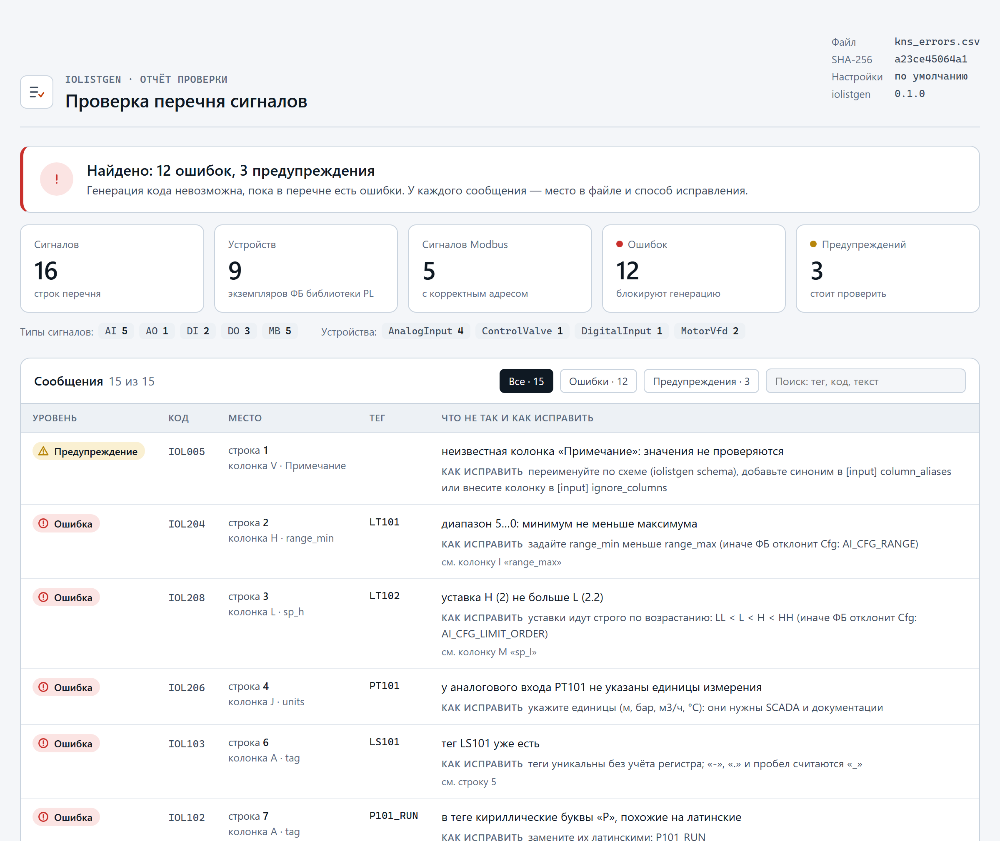
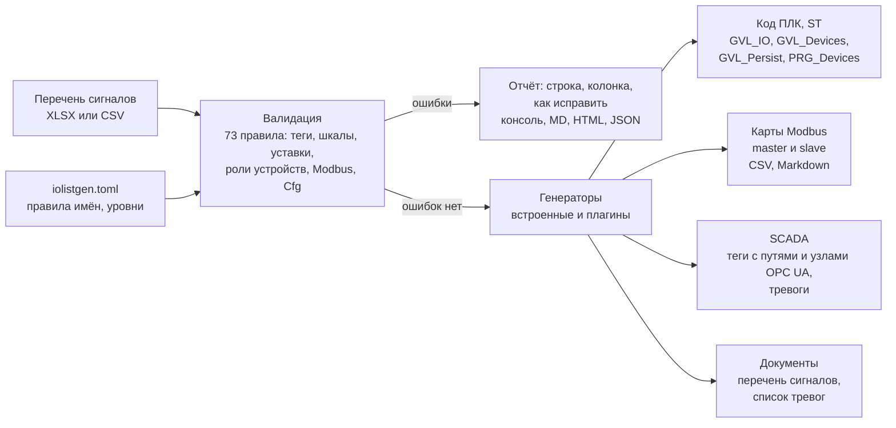

# iolistgen

[](https://github.com/<GITHUB_USER>/iolistgen/actions/workflows/ci.yml)
[](LICENSE)


Перечень сигналов — исходные данные любого проекта АСУ ТП, и при ручном заведении сотен сигналов
ошибки неизбежны: дубли тегов, перепутанные шкалы, пересекающиеся адреса Modbus, насос без
задания частоты. `iolistgen` проверяет перечень в Excel или CSV и в каждом сообщении называет
строку, колонку, что не так и как исправить, а затем генерирует по перечню код ПЛК для
библиотеки устройств plc-process-lib (CODESYS V3.5), карты обмена Modbus, импорт тегов SCADA и
таблицы для документации.

## Демонстрация

<p align="center">
  <picture>
    <source media="(prefers-color-scheme: dark)" srcset="docs/media/shot-validation-report-dark.png">
    <source media="(prefers-color-scheme: light)" srcset="docs/media/shot-validation-report-light.png">
    
  </picture>
</p>
<p align="center"><sub>Отчёт <code>iolistgen validate --report html</code> по учебному перечню с ошибками <code>pytests/data/kns_errors.csv</code>, версия 0.1.0</sub></p>

> _Плейсхолдер: GIF «перечень КНС-1 в Excel → `iolistgen validate` → `iolistgen generate` →
> импорт в CODESYS скриптом шаблона и сборка» появится после первой сборки сгенерированного кода
> с настоящей библиотекой plc-process-lib в CODESYS 3.5.17 (см. «Ограничения»)._

## Как это работает



Схема перечня реализует контракт plc-process-lib (раздел 20): строка — сигнал, строки с одним
`device` — один экземпляр ФБ, роль привязывает строку к входу или выходу ФБ, колонка `params`
задаёт любое поле Cfg литералом ST. Сигналы без ФБ (лампа, сирена, регистр, который читает
адаптер ПЧ, резервный канал) записываются с ролью `AUX`. Модули пакета и потоки данных —
[docs/ARCHITECTURE.md](docs/ARCHITECTURE.md#пакет-iolistgen).

## Быстрый старт

Нужен Python 3.10+; CODESYS и ПЛК не нужны.

```bash
pipx install .                                     # команда iolistgen; для разработки: pip install -e .
iolistgen validate examples/kns/io_list.csv        # КНС-1: 58 сигналов, 29 устройств — ошибок нет
iolistgen validate examples/kns/io_list.xlsx       # тот же перечень в Excel
iolistgen validate examples/broken/io_list_broken.csv --report html --out build   # 30 ошибок: код выхода 1
iolistgen generate examples/kns/io_list.csv --out build/kns   # ST, карты, SCADA, тревоги, перечень
iolistgen generate --list                          # генераторы, опции, плагины
iolistgen schema                                   # справочник колонок, ролей, параметров и правил
```

Справка по-русски с примерами — `iolistgen --help`, `iolistgen generate --help`. Коды выхода:
0 — ошибок нет, 1 — в перечне ошибки (с `--strict` — и предупреждения) или генератор завершился
ошибкой, 2 — неверные аргументы, настройки или файл. Генерация выполняется целиком или не
выполняется: при сбое любого генератора файлы не записываются.

## Перечень → код

Строки насоса Н1 из перечня КНС-1 ([examples/kns/io_list.csv](examples/kns/io_list.csv), пустые
колонки опущены):

| tag | signal_type | device | device_type | dev_no | role | io | mb_slave | mb_func | mb_reg | mb_type | link_power | params |
|---|---|---|---|---|---|---|---|---|---|---|---|---|
| P101_RUN | DO | P101 | MotorVfd | 11 | CMD_RUN | Q1.1 | | | | | ES301 | `tMinStop=T#30S; uiMaxStartsPerHour=10; stVfd.rSpeedMin_pct=60.0; …` |
| P101_RFB | DI | P101 | | | RUN_FB | D2.1 | | | | | | |
| P101_FLT | DI | P101 | | | FAULT | D2.2 | | | | | | |
| HS114 | DI | P101 | | | LOCAL | D2.3 | | | | | | |
| P101_CTW | MB | P101 | | | VFD_CTW | | 1 | 16 | 0 | WORD | | |
| P101_FREF | MB | P101 | | | SPEED_REF | | 1 | 16 | 1 | UINT | | |
| P101_STW | MB | P101 | | | VFD_STW | | 1 | 3 | 100 | WORD | | |
| P101_FACT | MB | P101 | | | SPEED_ACT | | 1 | 3 | 101 | UINT | | |
| P101_FCODE | MB | P101 | | | AUX | | 1 | 3 | 103 | UINT | | |

`iolistgen generate` даёт в `PRG_Devices` вызов со всеми привязками и `VAR_IN_OUT`, в
`GVL_Persist` (Persistent Variables) — Cfg с задержками из колонок и полями из `params`, номер
первой тревоги `dev_no · 10` и Retain устройства:

```st
// --- dev_no 11: P101 — Насос Н1 (MotorVfd) ---
// ПЧ: xCommOk, xVfd*, rSpeedAct_pct и rSpeedRef_pct — через адаптер приложения (GVL_IO.xP101_…)
// без входа ФБ (AUX, код приложения): GVL_IO.uiP101_FCODE — Насос Н1: код последней аварии ПЧ (читает адаптер ПЧ)
GVL_Devices.fbP101(
    xFbRun        := GVL_IO.xP101_RFB,
    xExtFault     := GVL_IO.xP101_FLT,
    xLocal        := GVL_IO.xHS114,
    xPowerOk      := GVL_Devices.fbES301.xValue,  // link_power
    xCommOk       := GVL_IO.xP101_CommOk,
    xVfdRunning   := GVL_IO.xP101_VfdRun,
    xVfdReady     := GVL_IO.xP101_VfdReady,
    xVfdFault     := GVL_IO.xP101_VfdFault,
    rSpeedAct_pct := GVL_IO.rP101_SpeedAct_pct,
    stCmd         := GVL_Hmi.stP101Cmd,
    stCfg         := GVL_Persist.stP101Cfg,
    stRetain      := GVL_Persist.stP101Retain);
GVL_IO.xP101_RUN          := GVL_Devices.fbP101.xQRun;
GVL_IO.xP101_VfdQRun      := GVL_Devices.fbP101.xQRun;
GVL_IO.xP101_VfdQReset    := GVL_Devices.fbP101.xQReset;
GVL_IO.rP101_SpeedRef_pct := GVL_Devices.fbP101.rSpeedRef_pct;

// GVL_Persist.pvl.st (VAR_GLOBAL PERSISTENT RETAIN), по возрастанию dev_no
    stP101Cfg : PL.ST_MotorCfg := (
        tFbStart := T#10S,
        tFbStop := T#15S,
        tMinStop := T#30S,
        uiMaxStartsPerHour := 10,
        stVfd := (
            rSpeedMin_pct := 60.0,
            rRampUp_pctps := 5.0,
            rRampDown_pctps := 5.0,
            xFbFromComm := FALSE,
            xCommLossIsFault := FALSE
        ),
        udiAlarmIdBase := 110
    );
    stP101Retain : PL.ST_DeviceRetain;  // режим, вывод из работы, наработка, операции
```

Слово состояния и задание частоты ПЧ разбирает адаптер приложения (`GVL_IO.wP101_STW` →
`xP101_VfdRun`…): карта регистров у каждой модели ПЧ своя. Каналы модулей объявлены в `GVL_IO`
без адресов `AT` и привязываются в дереве устройств; регистры Modbus — в той же карте обмена
`docs/modbus_master_map.csv`, где их видит проверка пересечений.

## Что проверяется

73 правила, у каждого код, уровень и подсказка «как исправить»:

- теги: идентификатор ST, дубли без учёта регистра после нормализации, кириллица вместо
  латиницы, правило именования из `iolistgen.toml` (по умолчанию — позиции в духе ГОСТ 21.208:
  `LT101`, `P101_RUN`; сверить с проектным стандартом);
- сигналы: описание, шкала (min < max), единицы у аналоговых, уставки LL < L < H < HH внутри
  шкалы, применимость задержек;
- устройства: тип и роли по контракту библиотеки, обязательные сигналы (ПЧ без задания частоты
  — ошибка), формы управления арматурой, стабильные уникальные номера, ссылки `link_power` и
  `link_fb`; строка насоса без `device` — подсказка, какое устройство указать;
- Modbus: пересечения адресов с учётом длины типа и битов внутри «линия, слейв, пространство»,
  функция и направление роли, тип данных и функция, бит регистра, порядок слов, адрес слейва
  (0 — отдельное правило, ослабляется для Modbus TCP), имена линий;
- каналы модулей ввода-вывода: два сигнала на одном канале;
- параметры Cfg (`params`): путь и тип поля по DUT библиотеки, конфликты с колонками и составом
  устройства, итоговая Cfg — тем же условиям, что `CheckConfig` ФБ (конфигурацию, которую ФБ
  отклонит, валидатор ловит раньше).

Excel читается так, как его видит человек: объединённые по вертикали ячейки («Устройство» на все
строки насоса) действуют в каждой строке, подзаголовки разделов пропускаются, десятичная запятая,
разряды через пробел, минус «−» из паспорта прибора, «—» вместо пустой ячейки и значения формул
(округлённые до 15 цифр, как в Excel) понимаются. Проектные правила ослабляются в
`iolistgen.toml`; структурные (тег, роль, тип устройства, адрес Modbus) — нет: без них модель не
строится.

## Генераторы

`iolistgen generate перечень.csv --out .` раскладывает файлы по местам проекта из шаблона:

| Генератор | Что даёт | Куда |
|---|---|---|
| `st-codesys` | ST для CODESYS 3.5: `GVL_IO` (каналы, Modbus, адаптеры ПЧ, сигналы AUX), `GVL_DevIdx`, `GVL_Hmi` (команды), `GVL_Persist` (Persistent Variables: Cfg с уставками перечня и Retain), `GVL_CfgProject`, `GVL_Devices` (экземпляры `PL.FB_*`), `PRG_Devices` (вызовы с привязками), `PRG_ApplyProjectCfg` | `src/GVLs/Generated/`, `src/POUs/Generated/` |
| `modbus-map` | карта обмена: master (сигналы MB перечня) и slave (блоки `stSts` для SCADA), CSV и Markdown | `docs/` |
| `scada-csv` | универсальный импорт тегов SCADA: пути переменных ПЛК, узлы OPC UA, единицы, шкалы, уставки; тревоги для SCADA | `scada/` |
| `alarm-list` | список тревог: номер `dev_no·10+слот`, код, приоритет, текст, уставка, задержка | `docs/alarms.csv` |
| `docs-table` | «Перечень сигналов» с переменными ПЛК | `docs/signal_list.md` |

Каждый файл начинается с `AUTO-GENERATED by iolistgen <версия> — не редактировать; источник:
<перечень>` и SHA-256 содержимого перечня. Генерация идемпотентна и детерминирована: повторный
запуск, как и пересохранение книги Excel без правок, ничего не меняет. Ручной код — логика
станции, адаптеры ПЧ, слой Modbus — лежит вне папки `Generated`. Для MasterSCADA 4D
документированного формата импорта тегов не найдено — вместо придуманного формата заготовка
плагина [`plugins/iolistgen-masterscada4d/`](plugins/iolistgen-masterscada4d/README.md). Форматы,
опции и решения — [docs/GENERATORS.md](docs/GENERATORS.md); свои генераторы — плагины с точкой
входа `iolistgen.generators` ([docs/PLUGINS.md](docs/PLUGINS.md)).

## Примеры

| Пример | Что показывает |
|---|---|
| [КНС-1](examples/kns/README.md) — `examples/kns/io_list.csv` и `.xlsx` | перечень флагманского объекта (проект 02): уровень, поплавки, давление, расход, газоанализаторы, три насоса с ПЧ по Modbus RTU (условная карта регистров), электроснабжение, сирена и лампы (роль AUX); теги по ГОСТ 21.208-2013; 58 сигналов, 29 устройств |
| [Синтетический перечень](examples/README.md#синтетический-перечень) — `examples/synthetic/io_list_300.csv` | 300 сигналов из генератора с зерном: все типы устройств, сигналов и ролей схемы; вход для замера |
| [Витрина ошибок](examples/README.md#витрина-ошибок) — `examples/broken/io_list_broken.csv` | намеренные ошибки всех групп правил: дубли, теги, шкалы и уставки, пересечения Modbus (в том числе 32-битного значения и битов регистра), состав устройств, параметры Cfg; [отчёт](docs/io_list_broken.validation.md) |

## Замер времени

Проверка перечня и запуск всех генераторов в одном процессе (медиана повторов) и команда
`iolistgen generate` целиком — со стартом Python и импортом зависимостей, которые занимают
большую часть её времени. Таблицу обновляет `python examples/benchmark.py`.

<!-- BEGIN benchmark -->
| Перечень | Сигналов | Проверка, мс | Генерация, мс | Проверка + генерация, мс | `iolistgen generate` целиком, мс |
|---|---:|---:|---:|---:|---:|
| `io_list_300.csv` | 300 | 71,1 | 192,8 | **263,9** | 1124,5 |
| `io_list.csv` | 58 | 17,3 | 91,5 | **108,8** | 948,0 |

Медианы; AMD Ryzen 7 7800X3D 8-Core Processor, логических ядер: 16, Windows-11-10.0.26300-SP0, CPython 3.12.10. Генераторы, методика и разброс — [benchmark.md](docs/benchmark.md); повторить — `python examples/benchmark.py`.
<!-- END benchmark -->

### Оценка ручной работы

> _Оценка ручной работы — заполнит автор: сколько времени занимает ручное заведение тех же
> 300 сигналов (GVL, экземпляры ФБ, вызовы, инициализация Cfg, карта Modbus, импорт SCADA) и
> сколько ошибок при этом обычно находят на пусконаладке._

## Тесты и проверки

| Проверка | Где | Что |
|---|---|---|
| pytest `pytests/` | CI, Python 3.10, 3.12, 3.13 | каждое правило — срабатывание и тишина на исправленном перечне; каждое ослабляемое правило, отключённое на перечне, где оно срабатывает, не ломает модель; загрузчики CSV и XLSX (разделители, BOM, cp1251, многострочные ячейки, объединённые ячейки, числа Excel); Cfg и зеркало CheckConfig; отчёты; плагины; CLI, в том числе «генерация целиком или никак»; property-based тесты hypothesis: поиск пересечений Modbus против полного перебора |
| ruff, mypy `--strict` | CI | пакет, тесты, скрипты примеров и инструменты шаблона |
| примеры `examples/` | pytest | КНС и синтетический перечень проходят проверку без сообщений; XLSX даёт ту же модель, что CSV; синтетический перечень пересобирается из зерна побайтно; у каждой строки витрины ошибок — ожидаемое сообщение, отчёт в `docs/` совпадает с выводом валидатора; фрагмент «Перечень → код» в README — дословно из вывода генератора |
| сборка wheel, установка, `pipx install .` | CI | команда `iolistgen` работает из установленного пакета |
| `docs/schema.md` | pytest | справочные таблицы документа совпадают с каталогами пакета |
| эталонные файлы генераторов | pytest | вывод всех генераторов по малому перечню `pytests/data/gen_fixture.csv` совпадает с `pytests/golden/` побайтно; повторный запуск ничего не меняет; плагины находятся точками входа |
| сгенерированный ST | pytest, CI | `st_lint --strict` и сборка раскладки без замечаний; RuSTy `plc --check` по заглушке plc-process-lib (`tests_support/pl_stub/`, сверена с каталогом пакета) для малых перечней, КНС-1 и синтетического; отрицательный контроль: испорченный вызов RuSTy отклоняет — `python tests_support/check_generated_st.py` |
| st_lint, iec_checker, RuSTy | CI | ST-раскладка шаблона |

```bash
python -m pip install -r requirements-dev.txt
python -m ruff check . && python -m ruff format --check . && python -m mypy && python -m pytest
python tests_support/check_generated_st.py      # сгенерированный ST: st_lint, assemble, RuSTy
```

## Документация

- [schema.md](docs/schema.md) — схема перечня: колонки, роли (в том числе `AUX`), Modbus,
  параметры Cfg, правила
- [CLI.md](docs/CLI.md) — команды, коды выхода, отчёты, файл настроек
  ([пример iolistgen.toml](docs/iolistgen.example.toml))
- [GENERATORS.md](docs/GENERATORS.md) — генераторы: файлы, форматы, опции, проверка ST без CODESYS
- [PLUGINS.md](docs/PLUGINS.md) — протокол генератора, контекст, точки входа
- [MANUAL_STEPS.md](docs/MANUAL_STEPS.md#9-код-сгенерированный-iolistgen-в-проекте-codesys) —
  импорт сгенерированного кода в CODESYS скриптом шаблона, подключение plc-process-lib,
  Persistent Variables, Modbus, SCADA
- [ARCHITECTURE.md](docs/ARCHITECTURE.md), [ASSUMPTIONS.md](docs/ASSUMPTIONS.md) — устройство
  и допущения; [LAYOUT.md](docs/LAYOUT.md) — раскладка ST; инструменты ST —
  [tools/README.md](tools/README.md)
- [examples/](examples/README.md) — примеры и скрипты; [КНС-1](examples/kns/README.md) — станция,
  группы сигналов, обозначения, условная карта регистров ПЧ
- [benchmark.md](docs/benchmark.md) — замер времени; [io_list_broken.validation.md](docs/io_list_broken.validation.md)
  — отчёт проверки витрины ошибок

## Ограничения и дальнейшие шаги

- Сгенерированный ST проверен линтером и RuSTy по заглушке библиотеки; сборка в CODESYS 3.5.17
  с настоящей plc-process-lib — следующий этап ([MANUAL_STEPS.md](docs/MANUAL_STEPS.md), раздел 9).
  Объект Persistent Variables в CODESYS 3.5.17 скриптом не создаётся — один ручной шаг.
- Значения Modbus генератор объявляет в типе прибора; 32-битные значения с порядком слов собирает
  слой Modbus приложения, слова ПЧ разбирает адаптер приложения — их генератор не пишет. Сигналы
  `AUX` получают переменную и место в картах, логику для них пишет код станции.
- Формат импорта тегов MasterSCADA 4D в документации вендора не описан: для неё — универсальный
  CSV, карта slave и заготовка плагина. Номер пространства имён и имя устройства в узлах OPC UA —
  сверить обзором сервера.
- Роли и допустимые типы сигналов — по контракту plc-process-lib 1.0: дискретные роли двигателя
  и арматуры (`RUN_FB`, `ZSO`…) — только DI, удалённые модули ввода-вывода по Modbus для них пока
  не предусмотрены. Роль `AUX` — расширение iolistgen, предложено в контракт.
- Правило тегов по умолчанию и предел длины имени устройства — допущения: сверить с проектным
  стандартом обозначений и ограничениями SCADA.
- XLSX читается по сохранённым значениям формул: формулы без значения (книга записана программой
  и не открывалась в Excel) iolistgen не пересчитывает, а сообщает о них. Многоуровневые заголовки
  (две строки шапки) и формат `.xls` не поддерживаются.
- Перечень — один лист книги или один CSV. Большой перечень, разложенный по листам участков,
  нужно собрать на один лист (проверки дублей, номеров и адресов — по всему перечню сразу); чтение
  нескольких листов — следующий шаг.

## Summary (EN)

`iolistgen` validates a process-control IO list (Excel or CSV) and generates PLC code for the
plc-process-lib device library (CODESYS V3.5), Modbus maps, a SCADA tag import and documentation.
A row is a signal, rows sharing `device` form one function-block instance, roles map rows to FB
pins, `params` sets any Cfg field as an ST literal, and `AUX` rows carry signals without an FB.
73 rules report file, row, column and a fix; structural rules cannot be silenced. Excel quirks
(merged cells, formulas, comma decimals, Unicode minus) are handled. Generation is all-or-nothing,
deterministic and idempotent; the ST is linted and type-checked with RuSTy against a library stub.
Python 3.10+, pydantic v2, openpyxl, Jinja2; ruff, mypy `--strict`, pytest and hypothesis in CI.

## Лицензия

[MIT](LICENSE) © 2026 <ИМЯ ФАМИЛИЯ>
