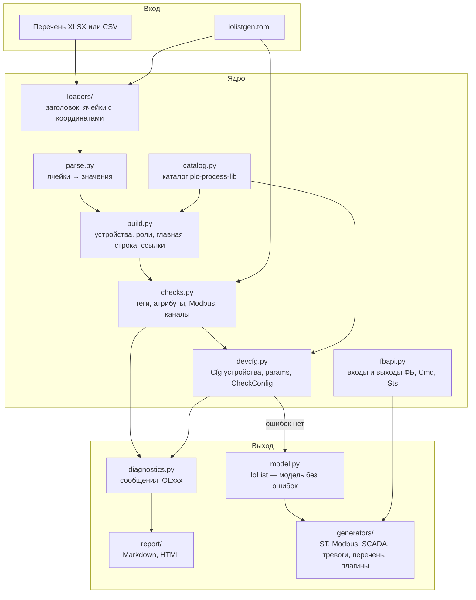
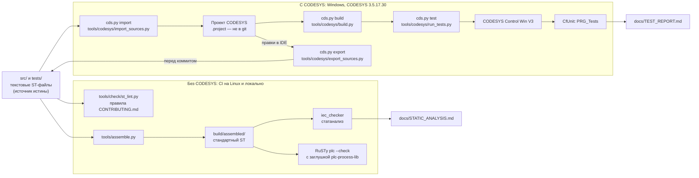

# Архитектура

Репозиторий состоит из двух частей: пакета Python `iolistgen` (проверка перечня сигналов и
генерация, раздел [«Пакет iolistgen»](#пакет-iolistgen)) и ПЛК-раскладки шаблона
plc-repo-template — каталоги `src/`, `tests/`, `tools/`, куда попадает сгенерированный ST и где
он проверяется без CODESYS и собирается в CODESYS (разделы ниже).

## Пакет iolistgen

| Модуль | Ответственность |
|---|---|
| `cli.py`, `__main__.py` | команды `validate`, `generate`, `schema`; справка по-русски; коды выхода 0/1/2 |
| `config.py` | `iolistgen.toml`: правила имён, адресация Modbus, чтение файла, уровни правил, опции генераторов; поиск рядом с перечнем |
| `columns.py` | колонки схемы: канонические имена, русские синонимы заголовков, уровень (строка, главная строка, устройство) |
| `loaders/` | CSV (UTF-8 с BOM, разделитель по заголовку, номера физических строк) и XLSX (openpyxl, выбор листа, объединённые ячейки, подзаголовки); поиск строки заголовка, привязка колонок, ячейки с координатами, SHA-256 содержимого таблицы |
| `parse.py` | разбор ячеек в типы (числа с десятичной запятой, целые 16#…, длительности, перечисления, params) с сообщениями об ошибках формата |
| `identifiers.py` | тег → идентификатор ST, дубли без учёта регистра, кириллица вместо латиницы |
| `build.py` | группировка строк в устройства: тип, `dev_no`, роли, главная строка, формы управления, ссылки `link_*`; простые сигналы без ФБ (роль `AUX`) |
| `checks.py` | проверки тегов и имён, атрибутов сигналов, адресов Modbus (включая пересечения), каналов модулей |
| `modbus.py` | функции, пространства, типы и длины, маски битов, поиск пересечений за O(n log n) |
| `catalog.py` | каталог библиотеки plc-process-lib 1.0.0: 7 типов устройств (в том числе `Pid` — без сигналов ввода-вывода), роли, поля Cfg с типами и умолчаниями, слоты тревог, константы `GVL_Const` таблицы 5.1 |
| `fbapi.py` | интерфейс ФБ библиотеки: входы и выходы экземпляров, поля Cmd, Sts (со смещениями по контракту 4.6) и Retain, перечисления состояний и причин событий тревог |
| `stvalues.py` | литералы ST: разбор и каноническая запись (`T#30S`, `30.0`, `16#FFFF`, перечисления) |
| `devcfg.py` | Cfg устройства: умолчания DUT, колонки, params, выводы из состава, зеркало `CheckConfig` |
| `diagnostics.py` | 74 правила с кодами и уровнями, сообщения с местом в файле, переопределение уровней (структурные правила не ослабляются) |
| `validate.py` | точка входа `check_file()`: весь конвейер, сводка, модель без ошибок |
| `model.py` | модель pydantic: `IoList`, `Device`, `Signal`, `ModbusAddress`, `DeviceCfg` и инициализатор ST |
| `report/` | отчёты Markdown и самодостаточный HTML (шаблон Jinja2 `templates/report.html.j2`) |
| `generators/base.py`, `registry.py` | протокол `Generator`, опции, `GeneratorContext` (идемпотентная и отложенная запись — генерация целиком или никак, заголовок, предупреждения), `GenerationError`, реестр встроенных генераторов и точек входа `iolistgen.generators` |
| `generators/plc.py` | модель имён ПЛК для всех генераторов: переменные `GVL_IO`, экземпляры, Cmd/Cfg/Retain, параметры вызовов, порядок вызовов, конфликты имён |
| `generators/stfmt.py`, `templating.py`, `csvout.py` | запись ST по правилам st_lint (инициализаторы в несколько строк, выравнивание, комментарии), окружение Jinja2, CSV с заголовком |
| `generators/st_codesys.py` + `templates/st/` | `st-codesys`: `GVL_IO`, `GVL_DevIdx`, `GVL_Hmi`, `GVL_Persist`, `GVL_CfgProject`, `GVL_Devices`, `PRG_Devices`, `PRG_ApplyProjectCfg`; сверка с прежним `GVL_Persist` (устройства и данные приложения) |
| `generators/persist_extra.py` | данные приложения для `GVL_Persist` из файла проекта (опция `persist_extra`): разбор объявлений, проверка имён |
| `generators/modbus_map.py` + `templates/modbus_map.md.j2` | `modbus-map`: карта master (сигналы MB) и slave (блоки `stSts`), CSV и Markdown |
| `generators/scada_csv.py`, `alarms.py` | `scada-csv` (теги, пути ПЛК, узлы OPC UA, тревоги для SCADA) и `alarm-list` (`docs/alarms.csv`); тексты тревог — шаблоны библиотеки `data/alarm_templates.csv` |
| `data/alarm_templates.csv` | шаблоны текстов тревог plc-process-lib 1.0.0 (копия `docs/alarm_templates.csv` библиотеки, две строки с исправленным разбиением колонок) |
| `generators/docs_table.py` | `docs-table`: «Перечень сигналов» с переменными ПЛК |
| `schema_doc.py` | справочник схемы для `iolistgen schema` и генерируемых блоков `docs/schema.md` |

Ошибка в одной ячейке не останавливает проверку: поле остаётся пустым, сообщение записывается,
зависящие проверки этой строки пропускаются. Модель для генераторов строится, только если
ошибок нет, поэтому обязательные по схеме поля в ней всегда заполнены.

## ПЛК-раскладка шаблона

Источник истины — текстовые файлы ST в `src/` и `tests/` (раскладка — [LAYOUT.md](LAYOUT.md)).
Проект CODESYS (`.project`) бинарный, поэтому в git его нет: он собирается из текстов скриптом
и после правок в IDE экспортируется обратно в тексты.

### Два контура проверок

| Контур | Где работает | Что ловит | Чего не ловит |
|---|---|---|---|
| Без CODESYS | CI (GitHub Actions, Ubuntu) и любой ПК с Python 3.12 | нарушения раскладки и правил именования, «магические числа», синтаксис и типы (RuSTy), находки статанализа (iec_checker) | особенности компилятора CODESYS, поведение в рантайме |
| С CODESYS | Windows с установленным CODESYS (переменные `CODESYS_EXE`, `CODESYS_PROFILE`) | ошибки компиляции CODESYS, результаты юнит-тестов CfUnit в Control Win | — |

Собранный текст в `build/assembled/` нужен только анализаторам: в CODESYS он не импортируется.
Варианты сборки (`iec`, `rusty`, `iec-checker`) описаны в [LAYOUT.md](LAYOUT.md#собранный-текст-buildassembled).

### Каталоги

| Каталог | Содержимое |
|---|---|
| `iolistgen/` | пакет Python: проверка перечня и генераторы (раздел «Пакет iolistgen») |
| `pytests/` | тесты пакета (pytest, hypothesis) и учебные перечни `pytests/data/` |
| `examples/` | примеры перечней (КНС-1 в CSV и XLSX, синтетический на 300 сигналов, витрина ошибок) и скрипты: `csv_to_xlsx.py`, `synthetic/make_synthetic.py`, `benchmark.py` ([README](../examples/README.md)) |
| `src/` | пример КНС-1, сгенерированный `iolistgen` (`GVLs/Generated`, `POUs/Generated`), и ручная точка входа `PRG_Main` (раздел ниже) |
| `tests/` | набор CfUnit `FB_ProjectCfg_Test` (coUnit 1.2.0.0, пространство имён `coUnit`) и `PRG_Tests` в той же раскладке; при импорте попадают в папку проекта `Tests` |
| `tests_support/` | заглушка plc-process-lib для RuSTy (`pl_stub/`), проверка сгенерированного ST (`check_generated_st.py`), сверка каталога с исходниками библиотеки (`check_library.py`) |
| `tools_project/` | инструменты этого репозитория поверх `tools/codesys`: `codesys_pvl.py` создаёт объект Persistent Variables в проекте `cds.py` импортом PLCopenXML |
| `tools/` | `assemble.py`, `check/` (линтер, запуск iec_checker и RuSTy), `codesys/` (`cds.py` — командная строка CODESYS на Python 3; скрипты CODESYS Scripting, IronPython 2.7; `config.json`) |
| `docs/` | документация, отчёты проверок, шаблоны ТЗ и ПМИ |
| `build/` | артефакты сборки и проверок, в git не хранится |

### Код в src/: пример КНС-1

С версии 0.2.0 в `src/` — не пример шаблона, а результат работы самого генератора: код по перечню
КНС-1 (`examples/kns/io_list.csv`) с настоящей библиотекой plc-process-lib 1.0.0.0. Он собирается в
CODESYS 3.5.17.30 ([README, «Тесты и качество»](../README.md#тесты-и-качество)) и держится в
согласии с генератором тестом `pytests/test_repo_src.py`.

| Объект | Вид | Откуда | Роль |
|---|---|---|---|
| `GVL_IO`, `GVL_DevIdx`, `GVL_Hmi`, `GVL_Devices`, `GVL_CfgProject` | GVL (`src/GVLs/Generated`) | `st-codesys` | каналы и регистры, номера устройств, команды HMI, 30 экземпляров `PL.FB_*`, уставки проекта |
| `GVL_Persist` | Persistent Variables | `st-codesys` | Cfg и Retain устройств по `dev_no`, данные приложения из `examples/kns/persist_extra.txt` |
| `PRG_Devices`, `PRG_ApplyProjectCfg` | программы (`src/POUs/Generated`) | `st-codesys` | вызовы устройств с привязками; «применить уставки проекта» |
| `PRG_Main` | программа (ручная) | — | логика станции в минимальном объёме: регулятор уровня `LIC101` (тип `Pid`, контракт 17.3), хранение задания оператора в `GVL_Persist`, вызов `PRG_Devices` |
| `FB_ProjectCfg_Test`, `PRG_Tests` | тесты (`tests/`) | — | Cfg проекта всех устройств принимает `CheckConfig` библиотеки; инициализаторы Cfg; «применить уставки проекта» |

Объект Persistent Variables скрипт CODESYS 3.5.17 не создаёт — его один раз создаёт
`tools_project/codesys_pvl.py`, дальше текст обновляет `cds.py import`
([MANUAL_STEPS.md](MANUAL_STEPS.md#93-импорт-в-проект-и-persistent-variables)). Дерева устройств
ввода-вывода, Modbus, адаптеров ПЧ и логики станции здесь нет: это проект kns-pump-station, генератор пишет только
свои файлы.
